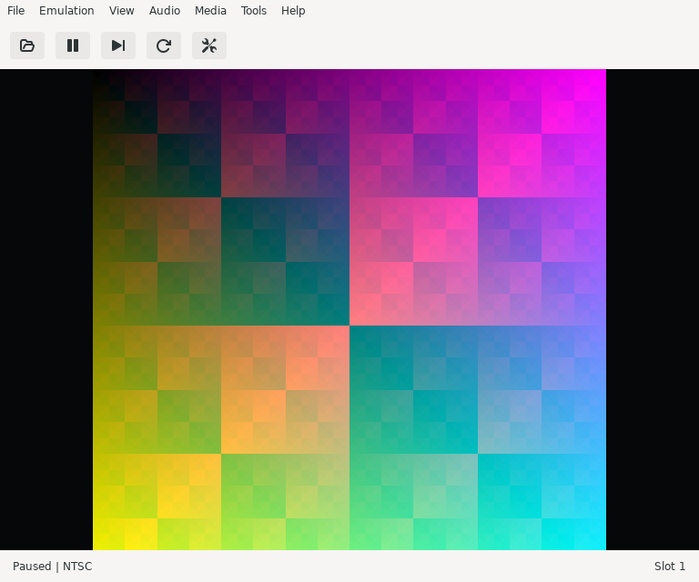
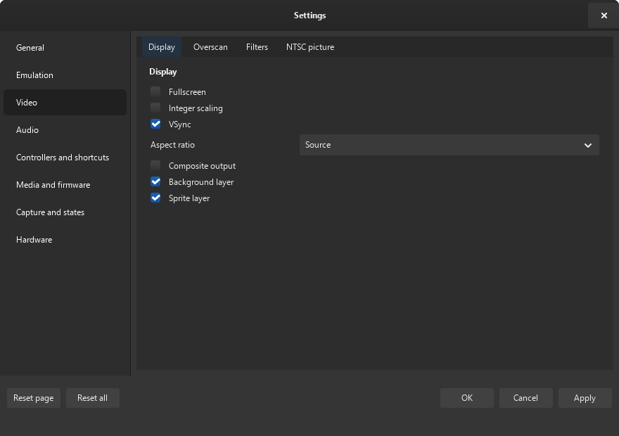
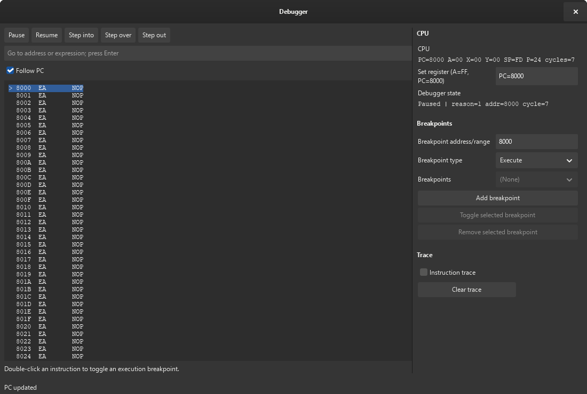
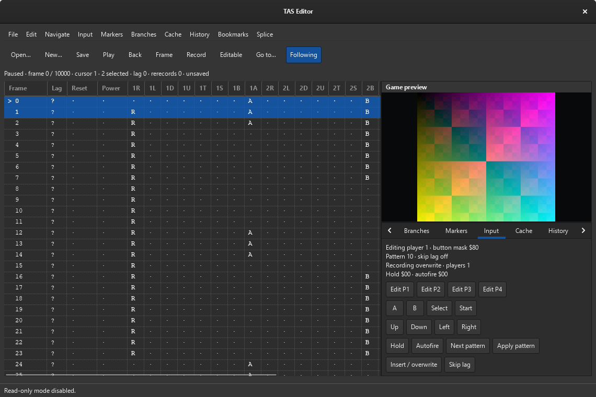

# Cupid NES

Cupid is an NES and Famicom emulator for Windows and Linux. It supports NTSC,
PAL, and Dendy timing, cartridge games, Disk System images, NSF/NSFe music,
StudyBox media, and supported VS System arcade images.

The GTK4 desktop has native menus, a compact toolbar, and separate windows for settings and tools.
You can keep the debugger, memory editor, or TAS timeline open beside the game.
On Windows, it follows the system's light or dark appearance. Controls are
borderless, with visible keyboard focus in both themes.



## Download and start

Get the Windows ZIP from [Releases](https://github.com/cupidthecat/cupid-nes/releases).
Extract it into a new folder and run `cupid-nes.cmd`. The package includes GTK and
its runtime libraries. Preview releases are also available.

Linux x64 previews are available as `cupid-linux-x64.tar.gz` for Ubuntu 24.04.
See [Linux download instructions](docs/getting-started.md#linux) for runtime dependencies.

Use **File > Open Game**, press **Ctrl+O**, or drop an image onto the game window.
Recent games remember archive members and patches. Opening another image switches
games in the same window. If loading fails, you can continue the current session.
Disk System and StudyBox images need their respective BIOS files.

## Settings and tools

Open **Settings** from the toolbar or press **Ctrl+Comma**, then choose a category
on the left. Longer video, audio, input, media, and hardware pages use tabs.
**Apply** validates and saves changes; **Cancel** discards pending edits. File
fields open native pickers, and audio settings list detected output devices.

Controllers are detected automatically until you choose a device. Saving other
preferences keeps automatic detection enabled, and controller choices saved for
one game stay with that game. See [configuration](docs/configuration.md) for
details about saved settings.



Memory Search shows results beside its range and comparison controls. The
debugger keeps registers and breakpoints beside the disassembly. In the header
editor, ROM, RAM, and console fields have separate groups, with named choices
for format, mirroring, and region.



| Task | Tools and guide |
| --- | --- |
| Inspect code and memory | [Debugger, assembler, memory search, watches, hex editor, and PPU viewers](docs/debugging.md) |
| Analyze execution | [Coverage, profiles, events, symbols, source, traces, and text extraction](docs/debugger-tools.md) |
| Edit input movies | [TAS timeline, branches, markers, bookmarks, checkpoints, Lua, and splicing](docs/tas.md) |
| Manage cheats | [Cheat editor and Game Genie conversion](docs/cheats.md), [checksum-matched database](docs/cheat-database.md) |
| Change presentation | [Shader presets, HD drafts, frame timing, history, and audio output](docs/presentation-tools.md) |
| Record output | [Screenshots, WAV, raw or ZMBV AVI, animated GIF, and overlays](docs/capture.md) |
| Manage sessions | [Automatic resume, state recording, game settings, and update checks](docs/session-tools.md) |
| Edit cartridge metadata | [iNES and NES 2.0 header editor](docs/header-editor.md) |
| Use expansion input | [Controllers and peripherals](docs/controls.md), [Family BASIC keyboard](docs/keyboard.md) |

The cheat editor supports up to 256 codes per game and saves UTF-8 descriptions.
If a catalog import fails, the previous catalog stays loaded.

The TAS editor opens FM2 movies and FM3 projects, with an input grid beside a
resizable game preview and editing tabs. You can save the full session as CTAS
or export a movie. The preview uses the same opaque colors as the main game view.
The converter checks game identity before converting supported power-on FCM movies.



These screenshots come from the native GTK regression application using a
generated diagnostic cartridge and input movie. The [desktop guide](docs/desktop.md)
explains the menus, individual windows, and settings.

## Default controls

| Key | Action |
| --- | --- |
| Z / X | A / B |
| Right Shift / Enter | Select / Start |
| Arrow keys | D-pad |
| Ctrl+O | Open a game |
| Ctrl+P / Ctrl+. | Pause or resume / advance one frame |
| Ctrl+R / Ctrl+Shift+R | Soft reset / power cycle |
| F5 / F6 | Save / load the selected state slot |
| Ctrl+F5 / Ctrl+F6 | Choose a file to save / load a state |
| F12 | Screenshot |
| Ctrl+F12 / Shift+F12 | Audio / video recording |
| Ctrl+Shift+F12 | Stop and finalize recording |

Use Settings to change keyboard and gamepad assignments or choose another input
profile. The first SDL controller drives player 1 by default. See
[controls](docs/controls.md) for device-specific input and shortcut precedence.

## Rendering and timing

The desktop paces emulation separately from expensive display updates. If
presentation falls behind, it shows the latest frame while preserving audio,
movie input, and captured frames. Frame Timing Statistics shows emulation and
display draw rates separately, along with interval jitter to help diagnose
uneven motion. See [performance troubleshooting](docs/troubleshooting.md#slow-video-in-a-large-window).

Frame waits use a high-resolution clock and process pending desktop paints
between frames, including late frames and the final spin wait. On Linux with
GTK 4.10 or later, the game view uses an opaque texture for GPU rendering or a
Cairo image for software rendering. GTK 4.8 uses Cairo. On Windows, the game view
uses accelerated SDL rendering even when GTK draws desktop widgets with Cairo.
Game Information shows the renderer and updates when you replace or unload a game.

GTK builds use a software SDL renderer and window surface for the hidden input
host. GTK draws the visible Linux window. Shader processing restores GTK's
graphics context after loading, rendering, or releasing a preset. You can
override the renderer for troubleshooting.

The TAS editor reuses its grid drawing until something changes. Follow Playback
moves directly to the current row, and preview updates do not repeat the window
layout.

## Build from source

The core uses C11, with C++17 cartridge modules and the EPSM sound engine.
GTK4 provides desktop widgets; SDL2 handles the emulation video pipeline, audio,
and controllers. Both a C and a C++ compiler are required.

On Ubuntu:

```sh
sudo apt install build-essential libgtk-4-dev libsdl2-dev libcurl4-openssl-dev
git clone https://github.com/cupidthecat/cupid-nes.git
cd cupid-nes
make -j4
./cupid-nes path/to/game.nes
```

On Windows, from the repository root:

```powershell
.\scripts\setup-gtk-windows.ps1
.\scripts\build-gtk-windows.ps1 -Jobs 8 -Package
Expand-Archive .\build\release\cupid-windows-x64.zip .\build\cupid-preview
.\build\cupid-preview\cupid-nes.cmd
```

Add `-Test` to run hardware regressions. `make GTK=0 test` builds the headless
regression suite. See [getting started](docs/getting-started.md) for toolchains,
output paths, Clang, and sanitizer builds.

## Hardware, saves, and accuracy

Cupid supports iNES, NES 2.0, and named UNIF boards. The optional `NesDB.txt`
database supplies legacy corrections and recognized headerless images. Explicit
command-line settings take precedence. The [hardware reference](docs/hardware.md)
lists mapper families, expansion sound, controller devices, supported layouts,
and remaining limits. Mapper support is not a per-game compatibility guarantee.

Cartridge saves normally live beside the ROM. Disk System writes use a separate
IPS overlay by default. Before quitting or replacing an image, Cupid finalizes
recordings and saves persistent data. If a write fails, it keeps the session open
so you can retry. If the state recorder cannot read its history index, it keeps
existing snapshots and reports the problem before allowing another capture.
See [saves and media](docs/saves.md), [states and replay](docs/replay.md),
[netplay](docs/netplay.md), and [HD packs](docs/hd-packs.md).

The [recorded accuracy checkpoint](docs/accuracy-checkpoints.md#regional-timing-checkpoint)
passed all 144 AccuracyCoin tests with none skipped or unfinished, the 91-ROM
diagnostic collection, and the 8,991-state canonical CPU trace in normal and
sanitizer builds. Separate regressions cover mappers, storage, input, and
expansion audio. Results apply to the tested revision and configuration; see
[accuracy notes](docs/accuracy.md) for coverage and limits.

The [GTK workflow](.github/workflows/gtk-desktop.yml) checks settings transactions,
input handling, debugger and assembler edits, TAS interactions, window resizing,
and rendered screenshots. It also builds and checks the Windows package.
[Development and testing](docs/development.md) describes how to reproduce checks.

## Documentation and license

Start with the [documentation index](docs/README.md), [configuration reference](docs/configuration.md),
or [troubleshooting guide](docs/troubleshooting.md). See [support](SUPPORT.md) for
bug reports and [contributing](CONTRIBUTING.md) for changes.

Cupid is GPL-3.0-or-later; see [LICENSE](LICENSE). Imported components retain their
licenses, including [emu2413](src/rom/emu2413.LICENSE) and
[ymfm](src/third_party/ymfm/LICENSE). [Credits](docs/credits.md) lists component
attribution, diagnostic sources, and hardware references.
